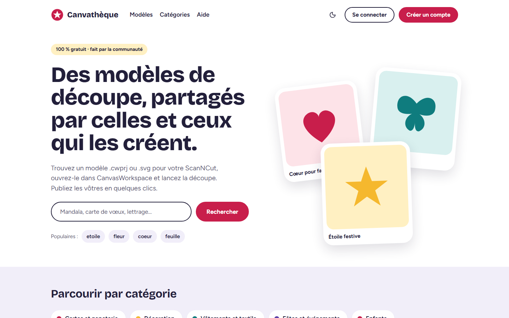
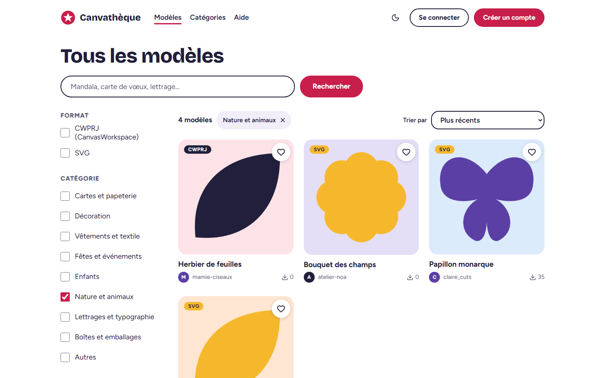
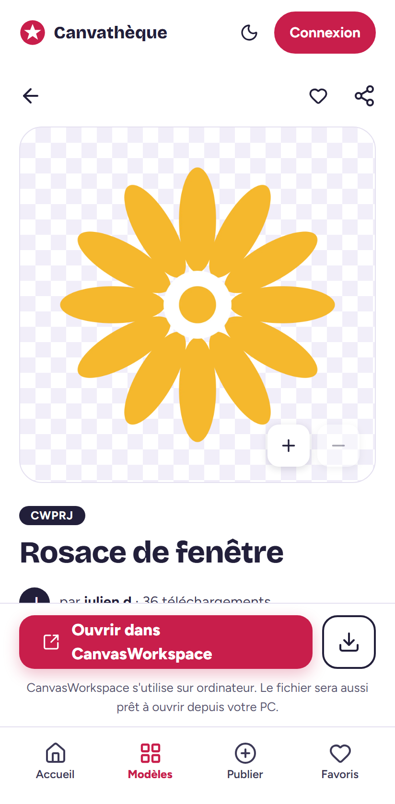
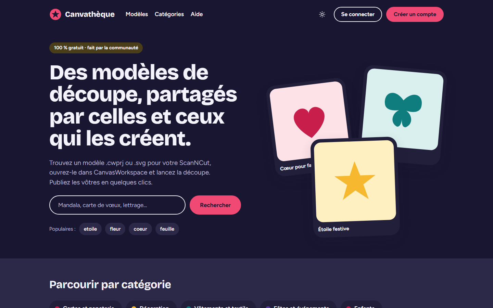
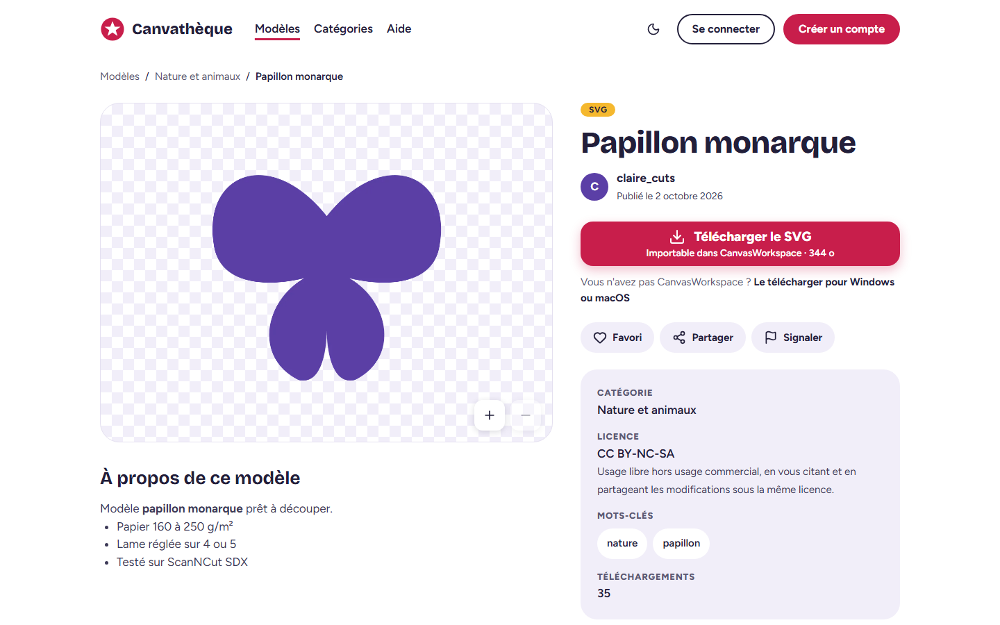
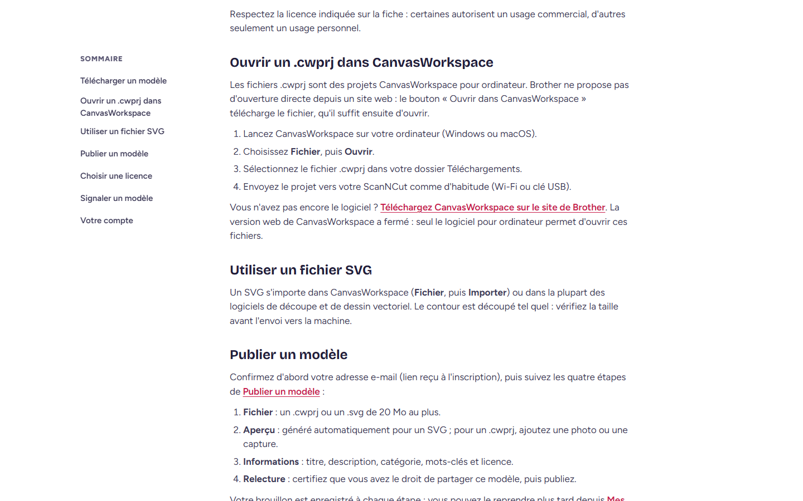

# Canvathèque

Application web communautaire et gratuite de partage de modèles de découpe pour Brother ScanNCut
(`.cwprj` et `.svg`).

> **État : v1 livrée (étapes 0 à 8).** Comptes, publication, catalogue public, téléchargement et
> favoris, modération, données personnelles, pages de contenu, commentaires ; accessibilité,
> performance et qualité vérifiées (voir [Qualité](#qualité)).

| Accueil                                                         | Galerie                                                        | Fiche (mobile)                                                                     |
| --------------------------------------------------------------- | -------------------------------------------------------------- | ---------------------------------------------------------------------------------- |
|          |  |  |
|  |            |          |

## Démarrage rapide (Docker)

Prérequis : Docker avec Compose v2, Node.js 22.12+ (pour les outils et les tests).

```bash
cp .env.example .env
```

Renseignez au minimum `AUTH_SECRET` (32 caractères ou plus) et `ADMIN_EMAIL`.

### Production locale

```bash
docker compose -f docker-compose.yml up -d --build --wait
```

- Application : <http://localhost:3000>
- Santé : <http://localhost:3000/api/health>
- Console MinIO : non exposée (voir le mode développement)

Les ports ne sont publiés que sur `127.0.0.1` (variable `APP_BIND`) : en production, le reverse
proxy est le seul point d'entrée.

Au premier démarrage, l'application applique les migrations, crée les 9 catégories, le compte
système « Auteur supprimé » et le compte administrateur `ADMIN_EMAIL` **sans mot de passe**.
Tant qu'il n'en a pas, un lien de définition valable 24 h lui est envoyé par e-mail à chaque
démarrage ; sans SMTP configuré, le lien est écrit dans les journaux :

```bash
docker compose logs app | grep admin_bootstrap
```

En développement, `ADMIN_PASSWORD` fixe directement le mot de passe.

### Développement

`docker-compose.override.yml` est chargé automatiquement : `next dev` avec rechargement à chaud,
ports PostgreSQL (5432), MinIO (9000, console 9001) et Mailpit (<http://localhost:8025>) exposés.

```bash
docker compose up -d
```

Ou, plus rapide sous Windows/macOS (recommandé par Next.js) : services dans Docker, Next sur l'hôte.

```bash
docker compose up -d postgres minio minio-init
npm ci
npm run db:deploy
npm run db:seed
npm run dev
```

Le seed est idempotent : catégories, administrateur, compte système, 5 membres de démonstration
(`<pseudo>@demo.canvatheque.test`, mot de passe `SEED_MEMBER_PASSWORD` ou aléatoire affiché),
10 tags et, si le stockage S3 est configuré (variables `S3_*`), 30 modèles publiés : SVG générés
par le seed lui-même et 4 `.cwprj` fictifs, passés par le même pipeline d'aperçus que les envois.

## Commandes

| Commande                                                      | Rôle                                                                           |
| ------------------------------------------------------------- | ------------------------------------------------------------------------------ |
| `npm run dev`                                                 | serveur de développement                                                       |
| `npm run build`                                               | build de production (sortie `standalone`)                                      |
| `npm run lint` / `npm run typecheck` / `npm run format:check` | qualité statique                                                               |
| `npm test`                                                    | tests unitaires et composants                                                  |
| `npm run test:backend`                                        | tests d'intégration (Docker requis : Testcontainers)                           |
| `npm run test:coverage`                                       | les trois projets, couverture fusionnée, seuils 80 % bloquants                 |
| `npm run test:e2e`                                            | Playwright contre la pile E2E (`E2E_BASE_URL`, défaut `http://localhost:3000`) |
| `npm run test:e2e:docker -- --project=firefox`                | mêmes E2E dans l'image Playwright officielle (Linux), contre la même pile      |
| `npm run lighthouse`                                          | Lighthouse mobile (4G lente simulée) des pages clés, médiane de 3, seuil 90    |
| `npm run screenshots`                                         | captures du README (`docs/screenshots/`)                                       |
| `npm run db:migrate` / `db:deploy` / `db:seed`                | migrations Prisma et données de démonstration                                  |
| `npm run bootstrap:admin`                                     | crée ou vérifie l'administrateur hors serveur                                  |
| `npm run sonar`                                               | analyse SonarQube locale, Quality Gate bloquant                                |

Les E2E lisent les e-mails dans Mailpit : lancez la pile avec la surcharge `docker-compose.e2e.yml`
(Mailpit actif, limites de débit relevées, PostgreSQL publié sur `127.0.0.1:5432`), puis
`npm run db:seed` : les tests du catalogue s'appuient sur les 30 modèles de démonstration. Les
scénarios de modération promeuvent un compte de test administrateur directement en base
(`DATABASE_URL` de `.env`). Premier lancement : `npx playwright install`.

## Vérification de bout en bout

```bash
docker compose -f docker-compose.yml -f docker-compose.e2e.yml up --build -d --wait
curl -f http://localhost:3000/api/health
npm run db:seed
npm run lint && npm run typecheck && npm run test:coverage
npm run test:e2e
docker compose --profile quality up -d sonarqube && npm run sonar
```

SonarQube local : <http://localhost:9002>. À la première analyse, le script remplace le mot de
passe administrateur par défaut (conservé dans `.sonar/admin-password`, hors dépôt), crée le
Quality Gate « Canvatheque » (Sonar way + couverture ≥ 80 %) et un jeton d'analyse.

En CI, avec le secret `SONAR_TOKEN`, l'analyse (couverture comprise) est publiée sur
[SonarCloud](https://sonarcloud.io/project/overview?id=Xwyk_canvatheque) ; sans lui, une instance
éphémère vérifie le Quality Gate. L'analyse automatique de SonarCloud doit rester désactivée.

## Architecture

| Couche        | Choix                                                                                               |
| ------------- | --------------------------------------------------------------------------------------------------- |
| Application   | Next.js 16.4 App Router, React 19, TypeScript strict, `proxy.ts`                                    |
| Interface     | Tailwind CSS 4, shadcn/ui (Radix), next-themes, next-intl (`messages/fr.json`)                      |
| Données       | PostgreSQL 16, Prisma 7 (adaptateur `@prisma/adapter-pg`)                                           |
| Fichiers      | Stockage S3 (MinIO, fork `pgsty`), URL présignées                                                   |
| Observabilité | pino (JSON, `x-request-id`, IP tronquées), `/api/health`, `/api/metrics` (Prometheus, jeton Bearer) |
| Tests         | Vitest (unit, components, backend avec Testcontainers), Playwright + axe                            |
| Qualité       | ESLint, Prettier, Husky + lint-staged, SonarQube, GitHub Actions                                    |

Arborescence : `app/` (routes), `components/` (interface partagée), `features/<domaine>/`
(logique métier), `lib/` (transverse), `prisma/` (schéma, migrations, seed), `tests/`,
`docs/` ([ADR](docs/adr/README.md), [design tokens](docs/design-tokens.md),
[maquettes](docs/mockups/)), `scripts/`, `docker/`. Vue détaillée : [docs/architecture.md](docs/architecture.md).

### Comptes

| Parcours                | Pages                          | Détails                                                                                                                                                  |
| ----------------------- | ------------------------------ | -------------------------------------------------------------------------------------------------------------------------------------------------------- |
| Inscription             | `/signup`                      | pseudo (3-30, immuable), e-mail, mot de passe (10+ caractères, hors 10 000 plus courants, jauge zxcvbn), CGU ; session ouverte et e-mail de confirmation |
| Connexion / déconnexion | `/login`, menu du compte       | message d'erreur générique, retour à la page demandée (`redirectTo`), compte banni refusé                                                                |
| Confirmation d'adresse  | lien `/check-mail/…`           | 48 h ; bandeau « confirmez votre adresse » avec renvoi ; nécessaire pour publier                                                                         |
| Mot de passe oublié     | `/forgot-password`, `/reset/…` | réponse identique que le compte existe ou non ; lien 1 h, usage unique ; ferme les autres sessions                                                       |
| Paramètres              | `/me/settings`                 | profil (présentation, site), changement d'adresse (confirmé à la nouvelle adresse, ancienne prévenue), changement de mot de passe                        |

Sessions en base : jeton aléatoire dans un cookie `httpOnly`, seul son hachage est stocké, révocation
immédiate au bannissement ([ADR-002](docs/adr/002-auth-sessions-en-base.md)). Limites de débit dans
PostgreSQL ([ADR-004](docs/adr/004-rate-limit-postgresql.md)) : connexion 10/15 min (IP + e-mail),
inscription 5/h (IP), réinitialisation 3/h (adresse), configurables par variables `RATE_LIMIT_*`.
Le bannissement se fait depuis l'administration (`/admin/members`, voir [Modération et administration](#modération-et-administration)).

### Publication

| Parcours    | Pages                                 | Détails                                                                                                                      |
| ----------- | ------------------------------------- | ---------------------------------------------------------------------------------------------------------------------------- |
| Publier     | `/publish` puis `/models/<slug>/edit` | assistant Fichier → Aperçu → Informations → Relecture ; le brouillon existe dès le premier fichier vérifié                   |
| Mes modèles | `/me`                                 | état (Brouillon, Publié, Masqué), Modifier, Dépublier, Supprimer (confirmation, irréversible)                                |
| Modifier    | `/models/<slug>/edit`                 | mêmes écrans, étapes libres ; un modèle publié garde son format ; réservé au propriétaire et aux administrateurs (404 sinon) |

- **Envoi** ([ADR-006](docs/adr/006-envoi-direct-presigne.md)) : formulaire POST présigné vers MinIO
  (clé imposée, taille bornée par la politique), progression et annulation ; le serveur ne relaie
  jamais le binaire entrant. 20 envois par heure et par membre (`RATE_LIMIT_UPLOAD_PER_HOUR`).
- **Contrôles** : extensions `.cwprj` et `.svg` (aperçus PNG, JPG, WebP de 5 Mo), nom nettoyé,
  double extension dangereuse refusée (`facture.exe.svg`), taille réelle revérifiée, signature lue.
  Un `.cwprj` est un bloc opaque (format chiffré, sans signature) : seuls les exécutables, scripts,
  pages HTML et SVG déguisés sont refusés.
- **SVG** : analyse XML stricte, entités et DOCTYPE à sous-ensemble interne refusés, 50 000 éléments
  au plus, puis DOMPurify (profil SVG) : pas de script, de `foreignObject`, de gestionnaire `on*`,
  de lien `javascript:` ni de ressource externe ; le fichier publié est la version nettoyée.
- **Aperçus** ([ADR-003](docs/adr/003-rasterisation-resvg.md)) : rendu resvg du SVG (fond
  transparent) ou image du membre, recadrage carré optionnel, rotation EXIF appliquée puis
  métadonnées supprimées, WebP 400 / 800 / 1600 px dans le bucket public `previews`.
- **Aperçu des `.cwprj`** ([ADR-013](docs/adr/013-miniature-cwprj.md)) : avec `CWPRJ_KEY` et
  `CWPRJ_IV` configurés, la miniature contenue dans le projet est extraite à l'envoi, côté
  serveur, et passe par le même pipeline. Le nom du motif propose le titre. Le membre peut
  toujours la remplacer par sa propre image. Sans clé, ou si le fichier ne se lit pas, il fournit
  une image comme avant. L'activation revient à l'éditeur du site (format propriétaire).
- **Doublons** : empreinte SHA-256 ; un fichier identique à un modèle publié est signalé, sans blocage.
- **Règles** : publication réservée aux adresses confirmées, catégorie, licence, aperçu et
  certification des droits obligatoires ; quota `MAX_MODELS_PER_USER` (brouillons compris,
  administrateurs exemptés). Suppression logique en base, objets MinIO effacés aussitôt
  ([ADR-008](docs/adr/008-suppression-logique.md)) ; envois abandonnés purgés au démarrage.

### Catalogue

| Écran         | Adresse                             | Détails                                                                                                                                          |
| ------------- | ----------------------------------- | ------------------------------------------------------------------------------------------------------------------------------------------------ |
| Accueil       | `/`                                 | recherche, catégories, « Populaires cette semaine » (téléchargements des 7 derniers jours, repli sur les plus téléchargés), « Derniers modèles » |
| Galerie       | `/models`                           | filtres format, catégorie, groupe de licences, mots-clés ; tris pertinence, récents, populaires, téléchargés ; état dans l'URL ; sans JS aussi   |
| Catégories    | `/categories`, `/categories/<slug>` | index avec nombre de modèles ; page de catégorie = galerie préfiltrée                                                                            |
| Fiche         | `/models/<slug>`                    | aperçu zoomable (boutons, molette, pincement), description Markdown, licence expliquée, mots-clés, « Dans le même esprit », autres modèles       |
| Profil public | `/members/<pseudo>`                 | présentation, site, statistiques, modèles publiés                                                                                                |
| API           | `GET /api/models`                   | pages suivantes de la galerie (JSON, mêmes paramètres, curseur)                                                                                  |

- **Recherche** ([ADR-005](docs/adr/005-recherche-tsvector.md)) : PostgreSQL `french_unaccent`
  (« etoiles noel » trouve « Étoile de Noël »), syntaxe `websearch` (guillemets, `-mot`).
- **Pagination** ([ADR-007](docs/adr/007-pagination-curseur.md)) : curseur opaque, première page
  rendue par le serveur, suivantes chargées au défilement (bouton « Charger plus » en secours).
- **Visibilité** : seuls les modèles publiés apparaissent ; brouillons et modèles masqués ne sont
  visibles que de leur auteur et des administrateurs (bandeau d'état, Modifier / Supprimer).
- **Référencement** : titre, description et URL canonique par page ; Open Graph et Twitter (aperçu
  du modèle ou image par défaut) ; données structurées `WebSite`, `Organization` et `CreativeWork` ;
  `/sitemap.xml` et `/robots.txt` générés à la demande. Les pages de recherche et de filtres sont
  en `noindex, follow`.
- **Performance** : Lighthouse (mobile, 4G simulée) ≥ 90 sur l'accueil, la galerie et la fiche ;
  accessibilité, bonnes pratiques et SEO à 100.

### Téléchargement et favoris

| Parcours                     | Où                                        | Détails                                                                                                                                                                |
| ---------------------------- | ----------------------------------------- | ---------------------------------------------------------------------------------------------------------------------------------------------------------------------- |
| Télécharger                  | fiche, `GET /api/models/<slug>/download`  | membre connecté (adresse confirmée ou non) ; URL présignée courte (`SIGNED_URL_TTL_SECONDS`), toujours en pièce jointe ; 60 par heure (`RATE_LIMIT_DOWNLOAD_PER_HOUR`) |
| Visiteur                     | modale sur la fiche                       | « Créez un compte gratuit pour télécharger » (inscription ou connexion), retour sur la fiche et téléchargement automatique                                             |
| Ouvrir dans CanvasWorkspace  | fiche d'un `.cwprj`                       | Brother ne documente aucun lien d'ouverture directe : téléchargement puis explications pas à pas (« Ne plus afficher » mémorisé dans le navigateur)                    |
| Favoris                      | cœur des cartes, pilule et icône de fiche | mise à jour immédiate puis confirmée ; visiteur : modale d'inscription                                                                                                 |
| Mes favoris, téléchargements | `/me/favorites`, `/me/downloads`          | onglets de l'espace membre avec Mes modèles et Paramètres                                                                                                              |

- **Compteurs** : un téléchargement compte une fois par jour et par membre (index unique partiel) ;
  « Populaires cette semaine » s'appuie sur ces téléchargements comptés.
- **Réponses** : 302 vers le fichier ; JSON `{ url }` avec `Accept: application/json` (bouton de la
  fiche, qui garde la page) ; erreurs JSON 401 (avec `loginUrl`), 404, 429 (`Retry-After`) ; un visiteur qui ouvre le lien
  directement est renvoyé vers la connexion, puis sur la fiche.
- `GET /api/models` renseigne les favoris d'un membre connecté (réponse privée, `Vary: Cookie`).

### Modération et administration

| Parcours        | Où                              | Détails                                                                                                                                                           |
| --------------- | ------------------------------- | ----------------------------------------------------------------------------------------------------------------------------------------------------------------- |
| Signaler        | pilule « Signaler » de la fiche | membre (pas sur son propre modèle) ; motif, précisions (obligatoires pour « Autre ») ; accusé de réception par e-mail ; 10 par jour (`RATE_LIMIT_REPORT_PER_DAY`) |
| Tableau de bord | `/admin` (menu du compte)       | chiffres clés, plus anciens signalements ouverts, dernières actions                                                                                               |
| Signalements    | `/admin/reports`                | à traiter (plus anciens d'abord) ou traités ; masquer ou supprimer le modèle, marquer comme traité, classer sans suite                                            |
| Membres         | `/admin/members`                | recherche (pseudo, e-mail), filtres ; bannir (sessions fermées, modèles publiés masqués sur demande), lever le bannissement, promouvoir                           |
| Modèles         | `/admin/models`                 | recherche (titre, auteur), filtre d'état ; masquer, réafficher, supprimer (aussi depuis la fiche)                                                                 |
| Journal         | `/admin/log`                    | toutes les actions, filtrables par type                                                                                                                           |

- **Raison obligatoire** pour chaque action, en modale de confirmation ; enregistrée dans le journal
  (avec le titre ou le pseudo visé, lisible même après suppression) et transmise par e-mail au membre
  concerné (modèle masqué, réaffiché ou supprimé ; compte suspendu ou rétabli).
- Masquer ou supprimer un modèle clôt tous ses signalements ouverts ; l'auteur voit le bandeau
  « Ce modèle est masqué » et la raison sur sa fiche.
- Un administrateur ne peut ni être banni ni se bannir ; le rôle ne se retire pas depuis
  l'interface. Un membre non administrateur obtient une 404 sur `/admin`.
- Un seul signalement ouvert par membre et par modèle (index unique partiel) : une fois traité, le
  modèle peut être signalé de nouveau.

### Données personnelles et pages de contenu

| Parcours             | Où                                                            | Détails                                                                                                                                                        |
| -------------------- | ------------------------------------------------------------- | -------------------------------------------------------------------------------------------------------------------------------------------------------------- |
| Exporter ses données | `/me/settings`, `GET /api/me/export`                          | fichier JSON en pièce jointe : profil, modèles, favoris, téléchargements, signalements, sessions ouvertes ; sans hachage ni jeton ; 10 par heure               |
| Supprimer son compte | `/me/settings` (zone danger)                                  | mot de passe et confirmation ; modèles publiés transférés à « Auteur supprimé » ou tout supprimer ; e-mail de confirmation ; session fermée                    |
| Pages de contenu     | `/about`, `/help`, `/legal`, `/legal/privacy`, `/legal/terms` | colonne 720 px, sommaire latéral à partir de 1024 px ; l'aide contient le pas à pas « Ouvrir un .cwprj dans CanvasWorkspace » ; présentes dans le plan du site |

- **Suppression vérifiée en base et dans MinIO** : brouillons, modèles masqués ou déjà supprimés
  (et tous les modèles en mode « Tout supprimer ») sont effacés avec leurs fichiers, aperçus et
  envois en attente ; favoris (compteurs mis à jour), téléchargements, sessions et jetons partent
  avec le compte ; signalements et commentaires sont conservés, anonymisés (compte système).
- Un administrateur ne supprime pas son compte depuis les paramètres.
- Mentions légales : `LEGAL_PUBLISHER`, `LEGAL_ADDRESS`, `LEGAL_HOST` et `CONTACT_EMAIL` ; une
  valeur absente est affichée « à compléter » plutôt qu'inventée.

### Commentaires

- Fiche d'un modèle publié : du plus récent au plus ancien, 20 par page (« Afficher les
  commentaires plus anciens »), texte brut de 1 000 caractères au plus ; visiteur : modale de
  connexion. 30 par heure et par membre (`RATE_LIMIT_COMMENT_PER_HOUR`).
- Suppression (après confirmation) par l'auteur du commentaire, l'auteur du modèle ou un
  administrateur ; celle d'un administrateur est journalisée avec un extrait (`/admin/log`).
- Compte supprimé : ses commentaires restent, signés « Auteur supprimé » (anonymisation).

### Sécurité (socle)

- CSP à nonces par requête (`script-src 'nonce-…' 'strict-dynamic'`), `frame-ancestors 'none'`,
  `nosniff`, `Referrer-Policy`, `Permissions-Policy`, HSTS si HTTPS ([ADR-011](docs/adr/011-csp-nonces-sans-cache-components.md)).
- Variables d'environnement validées au démarrage (`lib/env.ts`) : le serveur refuse de démarrer
  si une variable manque.
- Journaux sans e-mail, mot de passe ni jeton (masquage pino) ; `console.log` interdit par ESLint.
- Jetons stockés hachés (SHA-256) ; mots de passe en argon2id.
- Image Docker non root, `tini`, healthcheck.

## Qualité

| Critère                                           | Résultat                                                                                           |
| ------------------------------------------------- | -------------------------------------------------------------------------------------------------- |
| Tests (unit, composants, intégration)             | 670+ tests, couverture fusionnée ≥ 97 % des lignes, ≥ 92 % des branches (seuils bloquants 80 %)    |
| Bout en bout                                      | Chromium, Firefox, WebKit et Pixel 7 contre la pile Docker de production                           |
| Accessibilité                                     | axe (WCAG 2.2 AA) sans violation sur chaque écran, thème clair et sombre ; parcours clavier testés |
| Performance (Lighthouse mobile, 4G lente simulée) | accueil 92, galerie 90, fiche 90, aide 94 ; accessibilité, bonnes pratiques et SEO 100             |
| SonarQube                                         | Quality Gate passé, aucun problème ouvert                                                          |

- **Accessibilité** : `tests/e2e/a11y.spec.ts` parcourt toutes les pages (publiques, membre,
  administration dans `moderation.spec.ts`) ; `tests/e2e/keyboard.spec.ts` vérifie focus piégé,
  Échap et retour du focus dans les modales, filtres et menus au clavier. Les animations sont
  supprimées sous `prefers-reduced-motion`.
- **Performance** : JavaScript initial allégé (formulaires de la modale visiteur chargés à la
  première ouverture, textes serveur non transmis au navigateur, Zod hors des écrans publics),
  police des titres non préchargée. Le LCP simulé (≈ 3,1 à 3,6 s en 4G lente) est l'aperçu de la
  première carte ou le titre ; il dépend surtout du poids total chargé avant lui.
- **Firefox sous Windows** : si le navigateur ne démarre pas en local, `npm run test:e2e:docker`
  lance les mêmes tests dans un conteneur Linux (relais des ports 3000, 9000, 8025 et 5432).

## FAQ

**Le premier démarrage n'affiche aucun modèle.** Le seed n'est pas lancé automatiquement :
`npm run db:seed` (pile démarrée) crée catégories, membres, 30 modèles, un signalement et deux
commentaires de démonstration.

**Comment me connecter en administrateur ?** L'administrateur `ADMIN_EMAIL` est créé au
démarrage ; sans `ADMIN_PASSWORD`, un lien de définition du mot de passe est envoyé par e-mail et
affiché une fois dans les journaux (`docker compose logs app`). `npm run bootstrap:admin` en
réémet un.

**Les e-mails n'arrivent pas.** En développement ils sont dans Mailpit (<http://localhost:8025>,
profil `dev` ou surcharge E2E). Sans SMTP configuré, ils sont seulement journalisés.

**Les aperçus ne s'affichent pas en production.** `S3_PUBLIC_URL` doit être le sous-domaine public
du stockage (pas un sous-chemin : la signature des URL couvre le chemin) et figurer dans la CSP,
ce que fait `proxy.ts` à partir de cette variable.

**Peut-on ouvrir un .cwprj directement dans CanvasWorkspace ?** Brother ne documente aucun lien
d'ouverture : le site télécharge le fichier et affiche le pas à pas. Si un schéma est publié un
jour, il suffit de renseigner `CANVAS_WORKSPACE_PROTOCOL` (`features/downloads/`).

**Les pages légales affichent « à compléter ».** Renseignez `LEGAL_PUBLISHER`, `LEGAL_ADDRESS`,
`LEGAL_HOST` et `CONTACT_EMAIL`, et faites relire les textes (`messages/fr/content.json`).

**Un test E2E échoue sur des données inattendues.** Les E2E créent des comptes et des modèles :
sur une pile utilisée longtemps, repartez d'une base propre (`docker compose down -v`, puis
démarrage et seed) ; les tests du catalogue s'appuient sur les modèles de démonstration.

## Exploitation

### Mise en production (VPS)

1. `.env` : `APP_URL=https://votre-domaine`, `S3_PUBLIC_URL=https://s3.votre-domaine`,
   secrets forts (`AUTH_SECRET`, `POSTGRES_PASSWORD`, `S3_SECRET_KEY`, `METRICS_TOKEN`), SMTP,
   mentions légales (`LEGAL_PUBLISHER`, `LEGAL_ADDRESS`, `LEGAL_HOST`, `CONTACT_EMAIL`).
2. Reverse proxy HTTPS : [`docker/Caddyfile.example`](docker/Caddyfile.example) (deux hôtes :
   l'application et le stockage ; un sous-chemin casserait la signature des URL présignées).
3. `docker compose -f docker-compose.yml up -d --build --wait`.

Limites mémoire : application 1 Go, PostgreSQL et MinIO 512 Mo chacun (VPS 2 vCPU / 4 Go).

### Sauvegarde et restauration

```bash
sh scripts/backup.sh ./backups
sh scripts/restore.sh ./backups/20261018T150403Z
```

La sauvegarde produit `database.dump` (`pg_dump -Fc`) et `objects/<bucket>/` (`mc mirror`).
La restauration demande confirmation, arrête l'application, restaure base et objets, puis
redémarre. Sous Git Bash (Windows), préfixez par `MSYS_NO_PATHCONV=1`.

### Métriques

`GET /api/metrics` avec `Authorization: Bearer $METRICS_TOKEN` (404 si le jeton n'est pas défini) :
requêtes par route et statut, histogramme de latence (p50/p95 via `histogram_quantile`), erreurs,
téléchargements, métriques du processus Node.

## Feuille de route

| Étape | Contenu                                                                            | État |
| ----- | ---------------------------------------------------------------------------------- | ---- |
| 0     | Socle : design system, accueil, Docker, base, tests, CI                            | ✅   |
| 1     | Comptes : inscription, connexion, e-mails, réinitialisation, bannissement, limites | ✅   |
| 2     | Publication : envoi présigné, validation, nettoyage SVG, aperçus, assistant        | ✅   |
| 3     | Catalogue : recherche, filtres, galerie, fiche, profil, SEO                        | ✅   |
| 4     | Téléchargement et favoris, CanvasWorkspace                                         | ✅   |
| 5     | Modération et administration                                                       | ✅   |
| 6     | RGPD et pages de contenu                                                           | ✅   |
| 7     | Commentaires                                                                       | ✅   |
| 8     | Finition qualité                                                                   | ✅   |
